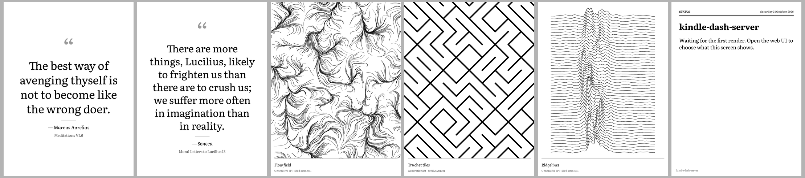

# kindle-dash-server

Self-hosted image server for an e-ink Kindle dashboard. It renders a PNG from interchangeable
**sources** (public-domain art, quotes, generative art…) and serves it to
[kindle-dash-pw3](https://github.com/pusi77/kindle-dash-pw3), with a small web UI to manage
sources and choose what is shown.

> Status: phase 2 (all default sources, plugins, source editor, rotation/schedule, settings,
> refresh schedule synced with the Kindle, low-battery badge). Full docs come in phase 3.



## Client contract (kindle-dash-pw3)

| | |
|---|---|
| Request | `GET <DASH_URL>` (default path here: `/dash.png`, configurable), `curl -f --max-time 30` |
| Headers | `X-Kindle-Battery: 0-100`; `Authorization: Bearer <DASH_TOKEN>` if a token is set |
| Image | PNG, **1072×1448 portrait**, **8-bit greyscale (colour type 0), no alpha** |
| Levels | 16 greys: 0x00, 0x11 … 0xFF (dithered here, Floyd–Steinberg by default) |
| Errors | anything but 200 → the Kindle keeps the previous image |

### Synced with the Kindle's refresh schedule

The server renders **once, shortly before each fetch** of the Kindle, and never in between, so
the device endpoint just returns a cached file. The fetch times come from the Kindle itself:
kindle-dash-pw3 sends its schedule as request headers

```
X-Kindle-Schedule: */15 7-22 * * *   # REFRESH_SCHEDULE
X-Kindle-Timezone: Europe/Rome       # TIMEZONE
X-Kindle-Sleep-After: 960            # SLEEP_SCREEN_INTERVAL
```

and the server replays `dash.sh`'s loop: with the values above it renders at 06:59, 07:14 …
22:29, then nothing until 06:59 the next day (at 22:45 the Kindle shows its sleep screen
instead of fetching). Content is rendered *for* the fetch time: daily picks, dates, the moon
phase and schedule slots are evaluated at 07:00, not at 06:59.

These headers need a small change to kindle-dash-pw3:
[`contrib/kindle-dash-pw3/0001-…patch`](contrib/kindle-dash-pw3/) (`git am` it in that repo).
Without it, set the same values under Settings → Refresh schedule.

The Kindle's `X-Kindle-Battery` is shown on the dashboard, and below a threshold (default 20 %)
a small battery badge is drawn on the image.

## Quick start

```sh
docker compose up -d --build          # UI on http://<host>:8080, data in ./data
```

or locally with uv:

```sh
uv sync
uv run kindle-dash-server --data-dir ./data --port 8080
```

Then on the Kindle, in `/mnt/us/dashboard/local/env.sh`:

```sh
DASH_URL="http://<server-ip>:8080/dash.png"
INTERVAL_MINUTES=15
```

## Layout of `/data`

```
settings.yaml     global settings (output, device path/token, location, schedule)
sources/*.yaml    one file per source (defaults are copied here on first start)
plugins/*.py      Python sources (see examples/plugins/countdown.py)
fonts/<family>/   extra fonts: regular.ttf, italic.ttf, bold.ttf
cache/            HTTP cache, cards, previews, current.png
state.sqlite3     runtime state
```

## Endpoints

- `GET /dash.png` — the device image (path: `device.path` in settings.yaml)
- `GET /preview/{source_id}.png` — render a source on demand (doesn't change the device image)
- `POST /render-now`, `GET /healthz`
- `/` dashboard, `/sources` source list and editor, `/display` pinned/rotation/schedule,
  `/settings`

Optional basic auth for the UI: `KDS_BASIC_AUTH=user:password`.

## Fonts and licences

Bundled fonts: Literata, EB Garamond and Noto Sans Symbols 2 (chess pieces), SIL Open Font
License 1.1 (see `fonts/*/OFL.txt`).
htmx is vendored under its Zero-Clause BSD licence.
